<p align="center">
  
</p>

<h1 align="center">万象卡域 · Wanxiang Deck</h1>

<p align="center">
  <strong>让青少年把一个灵感，炼成能玩、能展、能印的原创卡牌世界。</strong>
</p>

<p align="center">
  本地优先、主要交互界面全 Canvas 的桌面卡牌创作软件<br>
  Tauri 2 · PixiJS 8.19.0 · Rust 1.97+ · WebGL / Canvas · macOS arm64 Preview
</p>

<p align="center">
  <a href="#核心能力">核心能力</a> ·
  <a href="#真实生成套牌">真实套牌</a> ·
  <a href="#动图演示">动图演示</a> ·
  <a href="#场景画廊">场景画廊</a> ·
  <a href="#卡牌专门展厅">卡牌展厅</a> ·
  <a href="#玩法与完整盒装">玩法盒装</a> ·
  <a href="#点对点交换不是区块链市场">点对点交换</a> ·
  <a href="#印刷导出">印刷导出</a> ·
  <a href="#本地运行">本地运行</a> ·
</p>

<p align="center">
  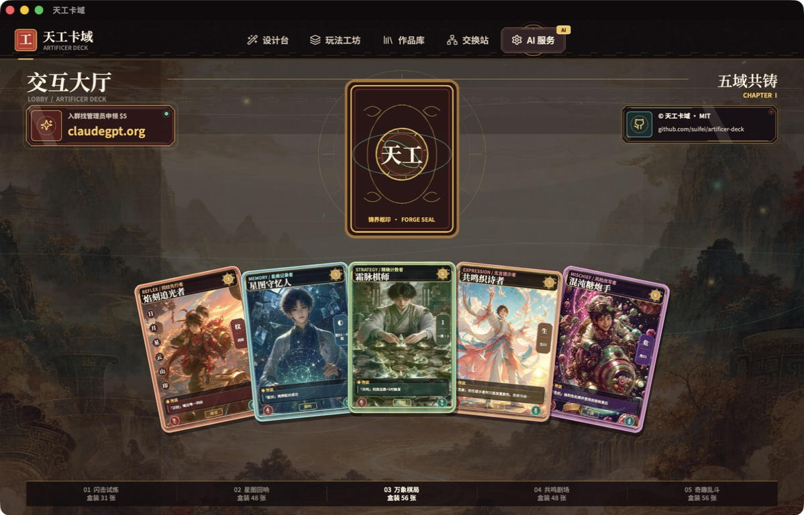
  <br>
  <sub>交互大厅 · 五域共铸。动态画卷、东方粒子、卡牌倾斜与融合转场共同构成创作入口。</sub>
</p>

万象卡域是一款面向青少年、家庭与桌游创作者的本地优先桌面卡牌创作软件。Tauri 2 承载本机存储、文件导出与点对点交换，PixiJS 通过 WebGL 优先、Canvas 降级的路径绘制主要交互界面；少量 DOM 只承担输入法、无障碍状态与启动错误提示。用户可以从五种经过构成校验的玩法出发，也可以像搭积木一样组合或编写规则；系统据此计算完整盒装、分批生成不重复卡牌、自动编写玩法说明书，并把作品与历史版本保存在本机。

> **当前版本：v0.1.2 开发预览**<br>
> 已在本机完成 macOS Apple Silicon（arm64）`.app` 与 DMG 构建验证。当前 `.app` 采用 ad-hoc 签名，DMG 未签名，二者均尚未经过 Apple 公证；Intel Mac、Windows 与 Linux 安装包尚未完成发布验证。本版本已删除 AI 功能：套牌生成改为本地模板拼装，不联网、不调用任何模型、不需要 API 密钥。

## 核心能力

| | |
|---|---|
| **主交互层全 Canvas**<br>水墨、工笔、剪纸、皮影、敦煌矿彩、漆器鎏金、青花瓷等 18 种原创方向贯穿界面和卡面。动态画卷、粒子、2.5D 倾斜与全息光层以 60fps 为目标，并会按真实帧耗时自适应降级。 | **规则先于数值**<br>完整牌数、牌型槽位、稀有度、数值与能力由确定性规则配方约束。世界观和美术表达来自本机内置样卡与规则配方，不能覆盖真正的游戏结算结构。 |
| **完整套牌与单卡重绘**<br>按玩法槽位分批创作完整盒装，每张牌都有独立角色、名称、构图与规则身份。不满意的单卡可以单独重绘，旧版本仍保留在本机。 | **玩法积木与自动说明书**<br>组合推荐机制、调整参数或编写原创模块，自动生成目标、设置、流程、胜负、变体、组件与快速参考，并随套牌导出印刷风格说明书。 |
| **本地版本库**<br>整套炼制、单卡重绘、手动留版与交换导入都有版本语义。用户可浏览同一作品的多个版本，再决定最终采用与导出的套牌。 | **物理牌桌展览**<br>Matter.js 固定步进模拟扇形展陈、整齐陈列与散落桌面；支持拖拽、惯性、全体翻面、统一卡背，以及 N / R / SR / SSR 稀有度鉴赏。 |

所有运行时静态资源均随桌面包本地提供：PixiJS、WebGL/Canvas 渲染路径、思源黑体与思源宋体、界面纹理、图标、背景和内置样卡均不依赖 CDN。

## 真实生成套牌

README 现在放入一套真实生成的《星图回响 · 完整配对套牌》。这不是单张样卡拼贴：前 40 张来自本机作品库中已经炼制好的《星图回响 · 炼制中》，再沿用上游版本的 AI 图像流程补生成 8 张（本版本已删除 AI，改为本地样卡拼装），最终补齐为 **24 对 / 48 张** 的完整记忆配对盒装。每张牌保留独立卡名、A/B 半契、稀有度、数值与玩法线索。

<p align="center">
  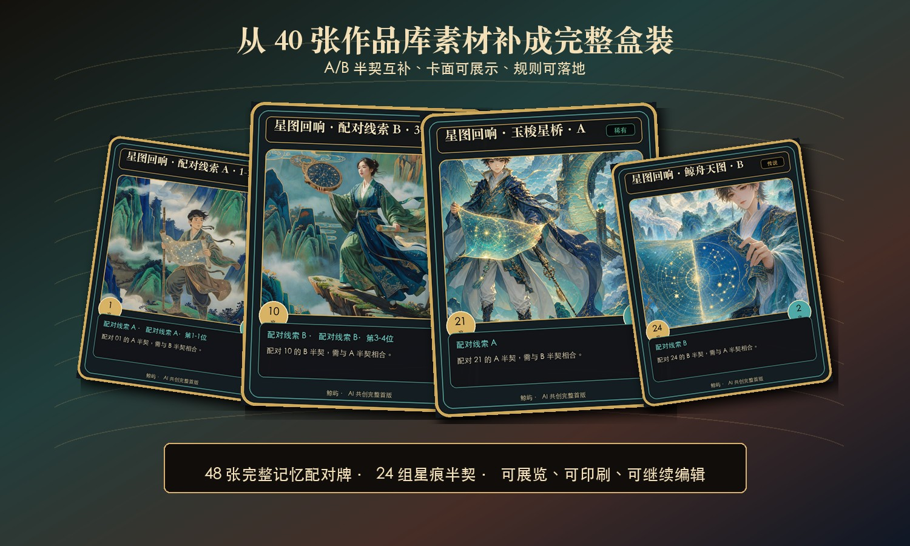
  <br>
  <sub>真实作品库素材继续补齐：48 张完整记忆配对牌，可展览、可印刷、可继续编辑。</sub>
</p>

### 动图演示

<table>
  <tr>
    <td width="50%" valign="top">
      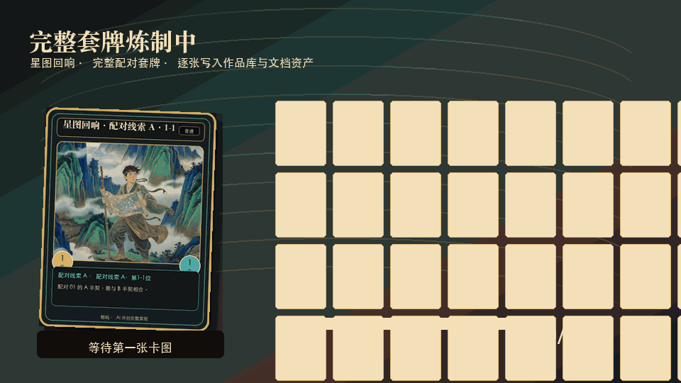
      <br><strong>制卡过程 · 逐张写入完整套牌</strong>
      <br><sub>从作品库素材到补齐缺口，进度阵列会按卡牌完成顺序点亮，生成结果同步成为可继续编辑的本机作品。</sub>
    </td>
    <td width="50%" valign="top">
      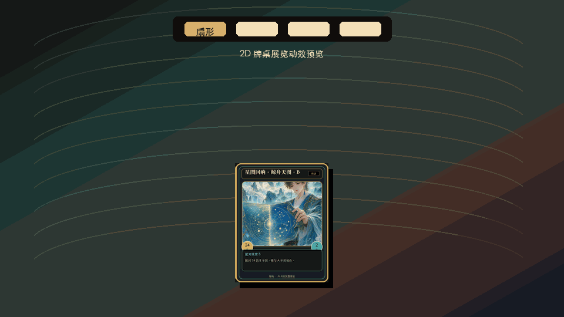
      <br><strong>牌桌展览 · 扇形、网格、翻面与散落</strong>
      <br><sub>2D 引擎展示卡牌扇形展开、网格归位、统一卡背翻转与物理牌桌散落效果。</sub>
    </td>
  </tr>
</table>

### 48 张完整牌面

<p align="center">
  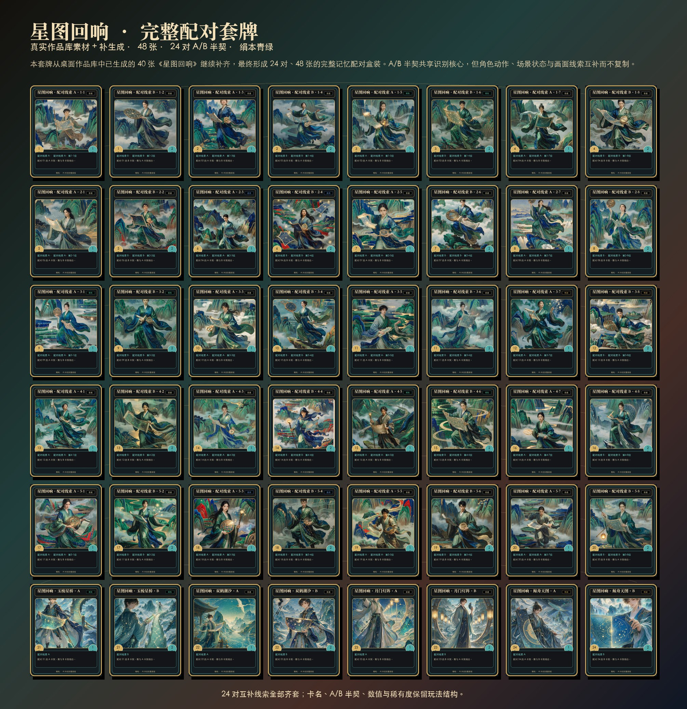
  <br>
  <sub>24 组星痕半契全部齐套；卡图来自本机作品库与补生成素材，卡面由同一套实时卡牌系统渲染。</sub>
</p>

## 场景画廊

<table class="gallery">
  <tr>
    <td width="50%" valign="top">
      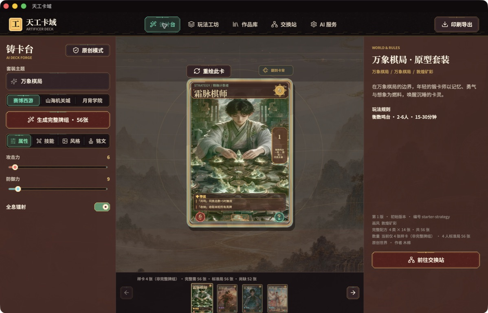
      <br><strong>铸卡台 · 套牌与单卡设计</strong>
      <br><sub>主题、风格、数值、能力、铭文与完整盒装生成集中在同一工作面；中央卡牌实时响应光照与视角。</sub>
    </td>
    <td width="50%" valign="top">
      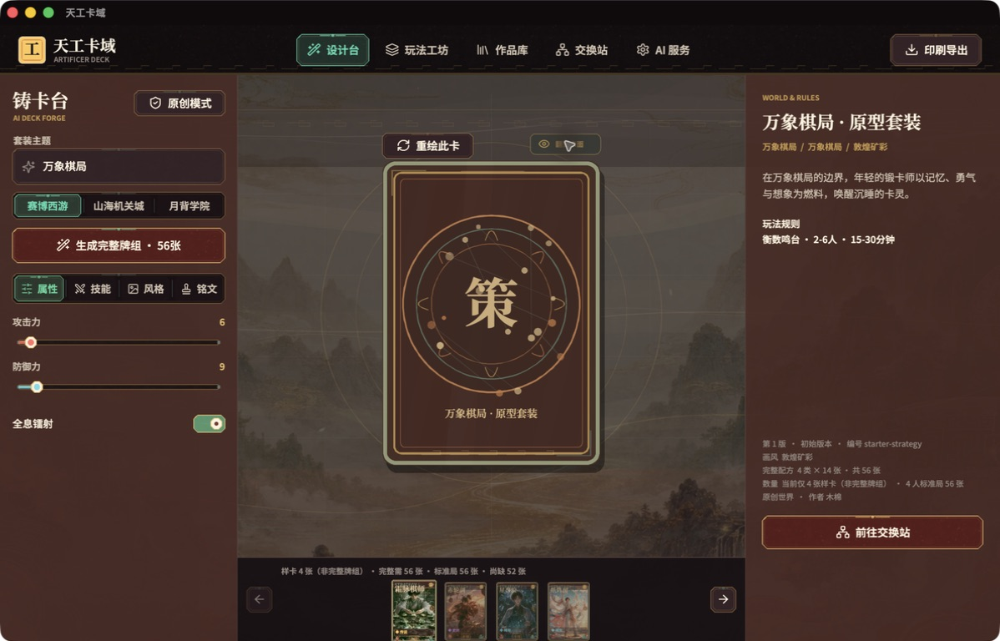
      <br><strong>统一卡背 · 翻转预览</strong>
      <br><sub>正面保留大幅角色画面，能力词条仅在需要时浮现；翻面可检查套装纹理、徽记和作者铭牌。</sub>
    </td>
  </tr>
  <tr>
    <td width="50%" valign="top">
      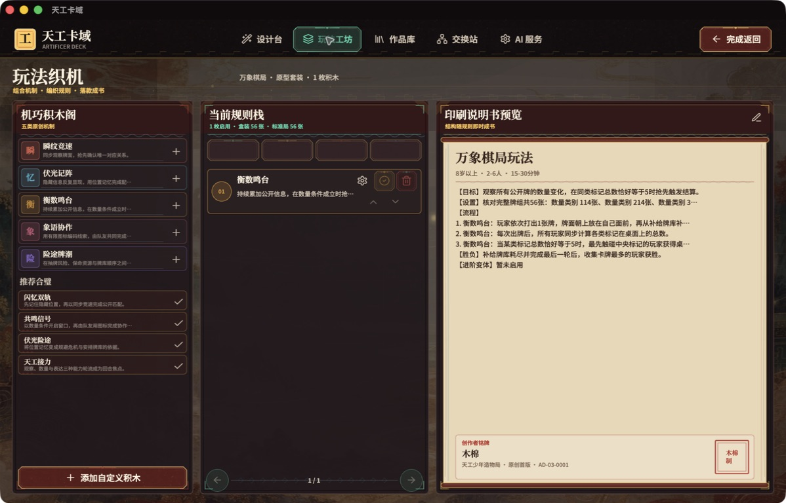
      <br><strong>玩法绣机 · 规则积木与说明书</strong>
      <br><sub>组合机制、参数与自定义牌型，实时计算盒装张数、单局投入和牌面密度，并生成可印刷说明书。</sub>
    </td>
    <td width="50%" valign="top">
      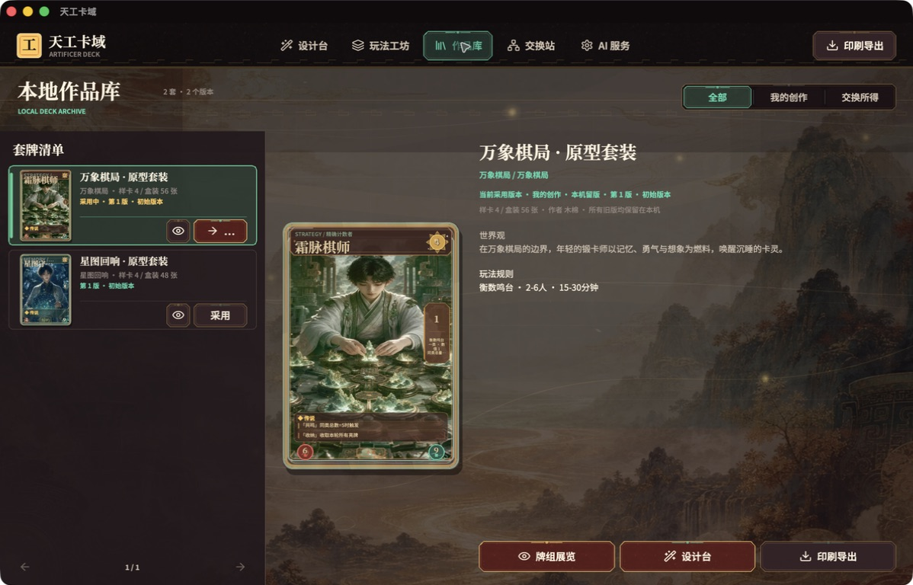
      <br><strong>本地作品库 · 多版本归档</strong>
      <br><sub>套牌、版本、采用状态和创作者信息全部保存在当前系统账户，可继续设计、展览或导出。</sub>
    </td>
  </tr>
  <tr>
    <td width="50%" valign="top">
      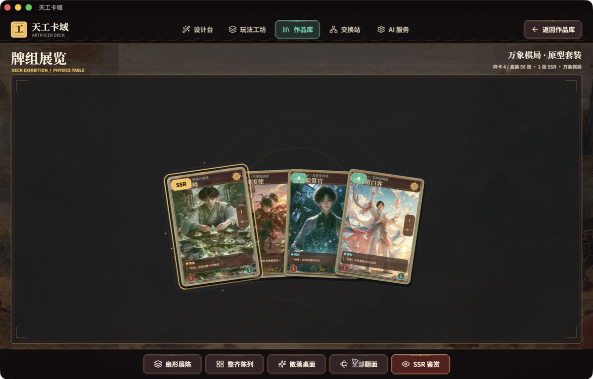
      <br><strong>牌组展览 · SSR 鉴赏</strong>
      <br><sub>像真实桌面一样摊开、拖拽和翻转作品，让卡牌质感、稀有标识与全息层成为创作成果的主角。</sub>
    </td>
    <td width="50%" valign="top">
      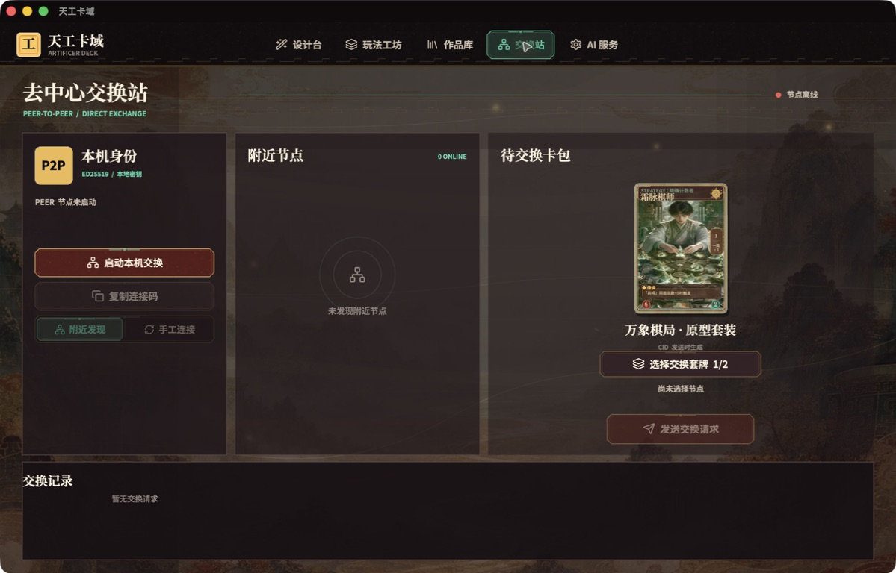
      <br><strong>去中心交换站 · 本机点对点直连</strong>
      <br><sub>本机身份、附近发现、连接码、待交换套牌和签名交换记录在一个场景中完成。</sub>
    </td>
  </tr>
  <tr>
    <td width="50%" valign="top">
      
      <br><strong>本地拼装 · 无需联网</strong>
      <br><sub>完整套牌由规则配方与本机内置样卡拼装，不调用任何模型、不需要密钥。</sub>
    </td>
    <td width="50%" valign="top">
      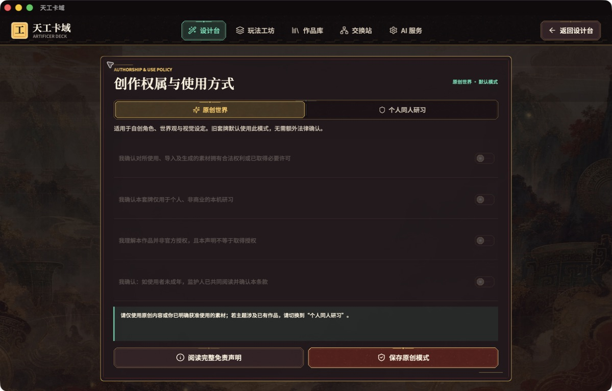
      <br><strong>创作权属 · 原创与个人同人研习</strong>
      <br><sub>原创世界默认启用；个人同人研习需要逐项确认权利、非商业边界、非官方属性与监护人知情。</sub>
    </td>
  </tr>
</table>

## 卡牌专门展厅

这里展示的是万象卡域自身 `CardView` 经过 WebGL 合成后的真实卡面，不是另行制作的宣传 mockup。每套原型包含不同角色、不同玩法身份与不同数值，同时共享一套材质、纹样、题名和稀有光层；本地拼装时会沿用所选方向，但不会把样卡角色当成固定模板。

<p align="center">
  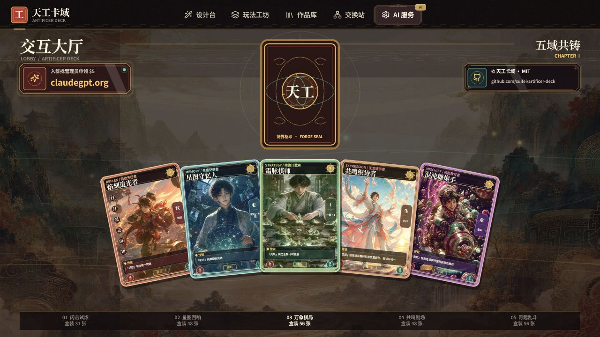
  <br>
  <sub>五域同台 · 漆器、绢本、矿彩、剪纸与霓虹工艺通过同一套实时卡面系统呈现。</sub>
</p>

### 闪击试炼 · 漆器鎏金

<p align="center">
  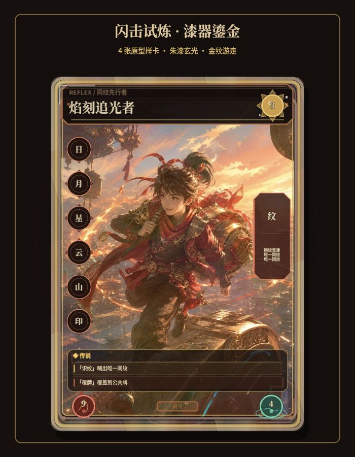
  <br>
  <sub>朱漆玄光、鎏金游线与六枚观察符号。任意两张牌仍由确定性配方保证唯一同纹。</sub>
  <br>
  同套插画：<a href="public/assets/cards/starter/reflex-2.jpg">02</a> · <a href="public/assets/cards/starter/reflex-3.jpg">03</a> · <a href="public/assets/cards/starter/reflex-4.jpg">04</a>
</p>

### 星图回响 · 绢本青绿

<p align="center">
  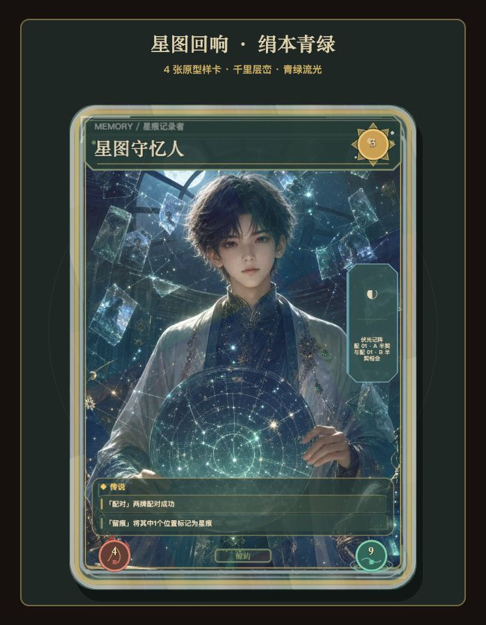
  <br>
  <sub>青绿流光、星图碎片与互补半印。每一对共享识别核心，但角色画面彼此不同。</sub>
  <br>
  同套插画：<a href="public/assets/cards/starter/memory-2.jpg">02</a> · <a href="public/assets/cards/starter/memory-3.jpg">03</a> · <a href="public/assets/cards/starter/memory-4.jpg">04</a>
</p>

### 万象棋局 · 敦煌矿彩

<p align="center">
  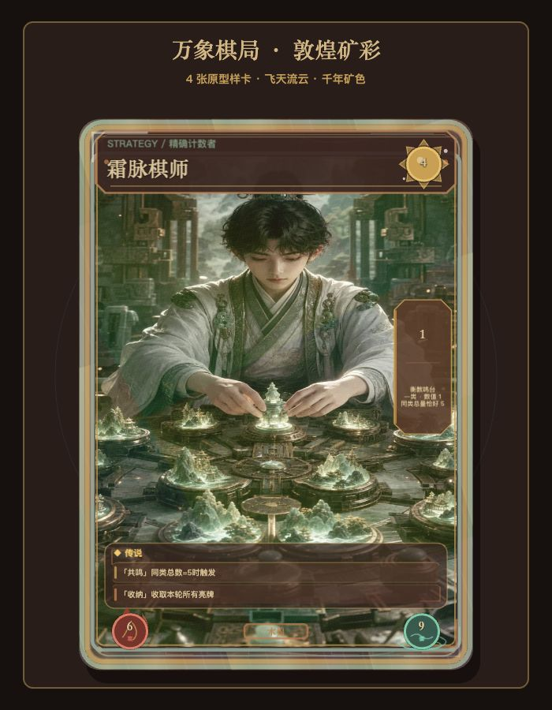
  <br>
  <sub>沉着矿色、土金边饰与数量类别印记。数值和触发关系直接来自玩法槽位。</sub>
  <br>
  同套插画：<a href="public/assets/cards/starter/strategy-2.jpg">02</a> · <a href="public/assets/cards/starter/strategy-3.jpg">03</a> · <a href="public/assets/cards/starter/strategy-4.jpg">04</a>
</p>

### 共鸣剧场 · 锦纸剪影

<p align="center">
  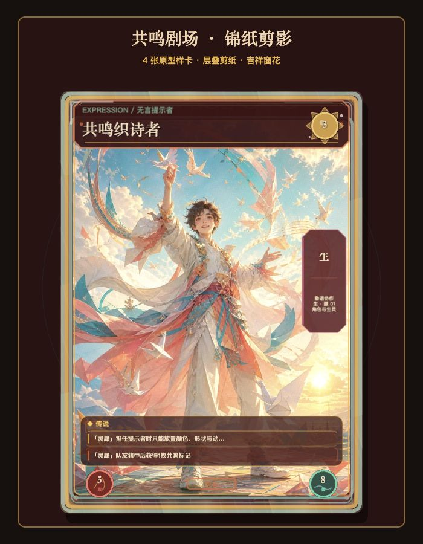
  <br>
  <sub>层叠纸纤维、吉祥窗花与语义类别印记。大幅角色画面保留完整动作和线索空间。</sub>
  <br>
  同套插画：<a href="public/assets/cards/starter/expression-2.jpg">02</a> · <a href="public/assets/cards/starter/expression-3.jpg">03</a> · <a href="public/assets/cards/starter/expression-4.jpg">04</a>
</p>

### 奇趣乱斗 · 霓虹国潮

<p align="center">
  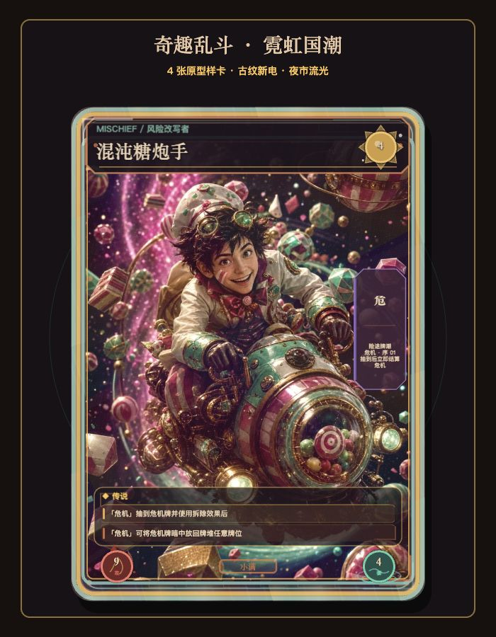
  <br>
  <sub>古纹新电、夜市流光与危机牌标识。功能类型和风险关系会随自定义玩法重新编译。</sub>
  <br>
  同套插画：<a href="public/assets/cards/starter/mischief-2.jpg">02</a> · <a href="public/assets/cards/starter/mischief-3.jpg">03</a> · <a href="public/assets/cards/starter/mischief-4.jpg">04</a>
</p>

卡面插画采用等比 `cover` 布局填满安全区，不会横向或纵向压扁；完整能力说明保留在悬停详情与印刷说明书中，正面只显示紧凑词条，让角色画面占据主要面积。内置卡面以 `700 × 900` 规格保存在本机，无需联网获取。

完整套牌本地生成按规则配方逐张派生：每个玩法槽位都得到一张内容独立的卡牌，卡名、能力、风味与玩法绑定由确定性规则给出，卡面按玩法分组循环使用本机内置样卡（每种玩法 4 张），进度阵列会按完成顺序逐张点亮，全程不联网。

## 从灵感到成品

<p align="center">
  <strong>选择玩法骨架</strong>　→　<strong>搭建规则积木</strong>　→　<strong>计算盒装槽位</strong>　→　<strong>本地分批拼装</strong>　→　<strong>绑定玩法数值</strong>　→　<strong>保存本地版本</strong>
  <br>
  <sub>最终作品可进入牌组展览、印刷导出；仅原创套牌可进入 P2P 交换。</sub>
</p>

生成完整套牌时，系统先建立每张牌的玩法槽位，再为每个槽位确定性地派生一张内容独立的卡牌。角色分类、能力词条、双数值和稀有度由确定性规则编译并复核；如果张数不符、槽位重复或玩法约束不成立，整套结果不会被当作可游玩的完整牌组保存。

## 玩法与完整盒装

五种内置模板关注玩法结构，不复刻示例桌游的角色、美术、名称或品牌素材。

| 玩法 | 核心机制 | 完整盒装 | 标准单局投入 |
|---|---|---:|---|
| **闪击试炼** | 任意两牌唯一同纹；31 个符号、每牌 6 个、两牌恰好共享 1 个 | **31 张** | 2–6 人使用整套 31 张 |
| **星图回响** | 24 组 A/B 互补配对，共享识别核心但不复制画面 | **48 张 / 24 对** | 2 人 24 张；3–4 人 36 张；5–6 人 48 张，必须成对取牌 |
| **万象棋局** | 4 类各 14 张，围绕默认目标值 5 进行数量触发 | **56 张** | 2–3 人取 3 个完整类别共 42 张；4–6 人 56 张 |
| **共鸣剧场** | 五类语义唯一目标，通过图标线索完成无语协作表达 | **48 张** | 3–4 人 24 张；5–6 人 36 张；7–8 人 48 张 |
| **奇趣乱斗** | 45 张功能牌 + 5 张危机牌 + 6 张护航牌 | **56 张** | N 人局使用 45 + N−1 + N 张；4 人为 52 张 |

自定义玩法支持 12–64 张完整盒装、至少 8 张标准单局投入。玩家可以自行定义牌型和数量，再叠加观察、记忆、数量、协作、风险、回合控制等推荐积木；系统先计算构成和投影密度，再生成卡面与说明书，并拒绝缺槽、重复牌型或过密牌面。

## 本地优先

| 断网仍可使用 | 需要联网 |
|---|---|
| 启动桌面软件、编辑套牌、调整玩法、设计卡背与铭牌 | —（本版本无联网功能） |
| 浏览作品库与历史版本、运行牌组展览 | 新生成图像与交换图像的远端安全审核 |
| 生成不需要新插画的本地内容、制作 RGB / PDF/X-4 文件 | 领取第三方服务额度、打开站点与 GitHub 链接 |

## 点对点交换，不是区块链市场

万象卡域不运行平台市场、积分账本、排行榜、中心数据库、DHT 或平台中继。桌面端只有在用户明确点击后才启动 libp2p 节点，以 QUIC 加密连接，使用 mDNS 发现局域网设备，并通过 Identify、Ping 与 Request/Response 完成卡包交换。

每台设备会持久保存 Ed25519 本机身份；卡包使用项目自定义的 BLAKE3 内容 ID（不是 IPFS CID）寻址并签名。本机会先验证数据结构、青少年文本规则、内容 ID、Peer ID 与签名，再由用户决定是否接受。交换记录以原子方式写入当前系统账户的私有目录，应用重启后可恢复最近状态。

> **真实网络限制**<br>
> 局域网体验最可靠。跨网络可交换连接码，但至少一端需要可路由 IPv6、公网 IPv4 或端口映射；双方均处于运营商级 NAT 或对称 NAT 后时，严格零服务器方案无法保证连接。签名只证明内容未被篡改并来自某个节点密钥，不代表实名、版权、唯一所有权或对方已删除副本；本地日志不是区块链账本，也不构成无信任的绝对原子交换。

“个人同人研习”套牌永远只保留在本机，不能进入 P2P；只有通过创作权属检查的原创套牌可以交换。

## 印刷导出

完整且通过牌型校验的套牌可以导出：

- 63 × 88 mm 标准卡牌，四边各 3 mm 独立出血与出血区外裁切线；
- 约 300 PPI 的卡面、镜像卡背和印刷风格玩法说明书；
- 低可见度套牌版本标记与用于版权追踪的本地水印信息；
- RGB 快速打样，或桌面端 PDF 1.6 / PDF/X-4 CMYK 印厂文件；
- 随包固定提供的 FOGRA39L Coated ICC、OutputIntent、A4 六拼页框与结构验证。

项目当前不输出 Adobe Illustrator（AI）文件。FOGRA39L 只描述一种涂布纸印刷条件，不能保证匹配具体纸张、油墨、专色、覆膜或印刷机；项目内自动验证也不能替代 Acrobat/callas 预检、印厂软打样与实物打样。

## 青少年安全与创作权属

本地内容检查会在保存前后检查主题、规则和可见文本；接收的非内置插画仍需通过内容检查，无法确认时按不通过处理。自动审核不能替代监护与人工判断。

“个人同人研习”模式仅允许用户在本机进行个人、非商业的学习、研究和同人创作。用户必须确认对导入、引用及生成所依据的素材拥有合法权利或必要许可，不得销售、收费交换、众筹或用于广告推广；未成年人须由监护人共同阅读并确认。

该模式不会授予或暗示原作授权，免责声明也不能使未经许可的使用当然合法。完成全部确认后，个人同人研习套牌可以在本机展览及个人印刷，导出物会写入“非商业同人创作 / 非官方授权”标记与完整声明；P2P 仍被禁止。公开传播或商业使用前，用户必须另行取得权利人授权。

## 免责声明

万象卡域按“现状”提供，属于开发预览软件。除 GNU GPL 明确规定的范围外，项目作者和维护者不对软件的准确性、稳定性、持续可用性、数据不丢失、设备兼容性、印刷效果、特定用途适用性或任何直接、间接损失作保证或承担责任。

本版本不包含 AI 服务，不会把提示词、规则上下文和图像发送到任何服务端点，也不需要 API 密钥。

用户对导入、生成、保存、印刷、发布、交换或商业使用的文字、图像、卡牌、字体和其他素材承担全部权利审查责任。用户必须确保拥有必要的著作权、商标许可、肖像许可和其他授权；软件的安全检查、免责声明、原创模式或个人同人研习模式都不构成权利授权、法律意见或对第三方权利的豁免。

P2P 交换只证明传输内容与节点签名的一致性，不证明实名身份、版权归属、唯一所有权、内容安全或对方删除了副本。QQ 群、第三方站点和体验额度均不属于本软件运行所必需的组成部分，相关规则和服务变化以其运营方公告为准。

## 本地运行

建议使用 Node.js 22 LTS、Rust 1.97+，以及当前平台要求的 Tauri 2 系统依赖；Vite 至少需要 Node.js 20.19 或 22.12。

```bash
npm ci
npm run desktop
```

浏览器预览可使用 `npm run dev`，但 P2P 节点、原生 PDF 保存窗口和私有应用目录只在 Tauri 应用中可用。

### 构建与验证

```bash
npm test
npm run build
cargo test --manifest-path src-tauri/Cargo.toml
npm run desktop:build
npm run qa:desktop-bundle
```

macOS 本地构建产物：

```text
src-tauri/target/release/bundle/macos/万象卡域.app
src-tauri/target/release/bundle/dmg/万象卡域_0.1.2_aarch64.dmg
```

`npm run desktop:build` 会把安装说明和“一键安装.command”一并写入 DMG 根目录。脚本只会在用户主动打开并确认后运行：将应用复制到 `/Applications`，请求管理员权限，再执行 `sudo xattr -dr com.apple.quarantine`。该操作不会替代来源核验、SHA-256 校验或 Apple 公证。

印刷校样与结构验证：

```bash
npm run qa:print-proof
npm run qa:print-proof:verify
npm run qa:pdfx4
npm run qa:pdfx4:verify -- "/absolute/path/to/deck--pdfx4.pdf"
```

### GitHub 自动发布

向 `main` 推送符合 `vMAJOR.MINOR.PATCH` 格式的版本标签后，GitHub Actions 会在 Apple Silicon macOS runner 上自动构建 `.app` 与 `.dmg`，生成 SHA-256 校验文件，并创建 GitHub Release 上传 DMG：

```bash
git tag v0.1.2
git push origin v0.1.2
```

当前发布包采用 ad-hoc 签名。若要启用 Apple 公证，需要在 GitHub Actions secrets 中配置 Apple Developer 的公证凭据；没有这些凭据时，工作流仍会完成 DMG 构建和发布。

## 许可与第三方材料

项目源代码依据 [GNU GPL v3 or later](LICENSE)（`GPL-3.0-or-later`）发布。随包字体、ICC 色彩配置、示例卡图、展示素材与第三方组件分别受其自身许可或权利声明约束，详见 [THIRD_PARTY_NOTICES.md](THIRD_PARTY_NOTICES.md) 与 [本地字体说明](public/assets/fonts/README.md)。产品名与标准名只用于说明兼容性或目标印刷条件，不表示相关权利人对本项目的认可或背书。

欢迎通过 [CONTRIBUTING.md](CONTRIBUTING.md) 参与维护；安全问题请先阅读 [SECURITY.md](SECURITY.md)，不要在公开 issue 中提交密钥或私人卡包。

## 本地生成说明

本版本已删除全部 AI 功能：没有 AI 设置页、没有兼容 OpenAI 的服务端点、没有 `server/` 后端、桌面端也没有 AI 生成命令。铸卡台的“生成完整牌组”改为本地生成：按规则配方算出完整盒装的每个槽位，再为每个槽位确定性地派生一张内容独立的卡牌（名字、称号、数值、技能均不重复），卡面按玩法分组循环使用本机内置的 4 张样卡（每种玩法）；“重绘此卡”改为在同玩法的 4 张内置样卡之间切换卡面。全程不联网。

<p align="center">
  <a href="https://github.com/wuerlongxin/artificer-deck">github.com/wuerlongxin/artificer-deck</a>
  <br>
  <sub>Copyright © 2026 Wanxiang Deck contributors · Source code licensed under GPL-3.0-or-later</sub>
</p>
